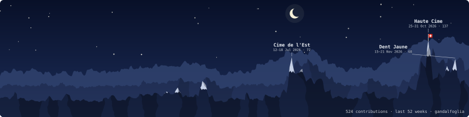
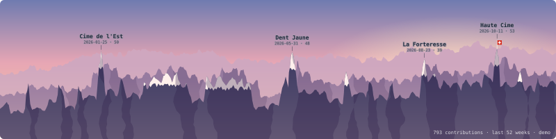
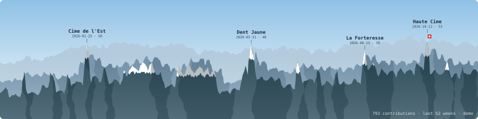
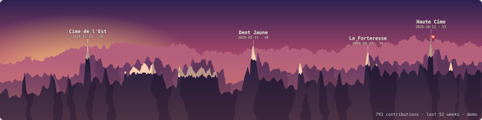
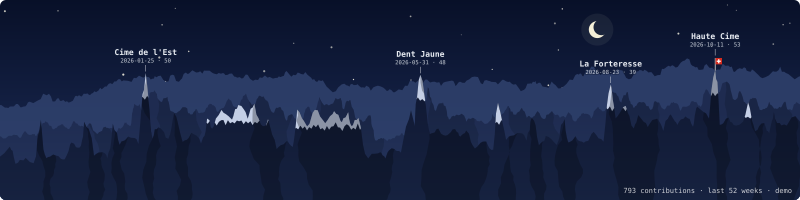

# dents

Your GitHub contribution year as a side-view Swiss Alpine range, named after the
Dents du Midi above Martigny (Valais). Weekly totals become three layered ridges;
the busiest weeks become Haute Cime, Cime de l'Est, Dent Jaune and friends. The
sky follows the hour in Europe/Zurich: dawn, day, dusk or night.

<p><sub>Live, re-rendered every 6 hours:</sub></p>

<picture>
  <source media="(prefers-color-scheme: dark)" srcset="dist/dents-dark.svg">
  
</picture>

## Four skies

The sky follows the hour in Europe/Zurich at render time. These previews use
`--fake` data and switch to the dark variant with your theme.

<table>
  <tr>
    <td width="50%" align="center">
      <picture>
        <source media="(prefers-color-scheme: dark)" srcset="assets/skies/dawn-dark.svg">
        
      </picture>
      <sub><b>Dawn</b> · 05–09h Zurich</sub>
    </td>
    <td width="50%" align="center">
      <picture>
        <source media="(prefers-color-scheme: dark)" srcset="assets/skies/day-dark.svg">
        
      </picture>
      <sub><b>Day</b> · 09–17h Zurich</sub>
    </td>
  </tr>
  <tr>
    <td width="50%" align="center">
      <picture>
        <source media="(prefers-color-scheme: dark)" srcset="assets/skies/dusk-dark.svg">
        
      </picture>
      <sub><b>Dusk</b> · 17–21h Zurich</sub>
    </td>
    <td width="50%" align="center">
      <picture>
        <source media="(prefers-color-scheme: dark)" srcset="assets/skies/night-dark.svg">
        
      </picture>
      <sub><b>Night</b> · 21–05h Zurich</sub>
    </td>
  </tr>
</table>

The tallest weeks are named after the summits of the Dents du Midi, by rank:
**Haute Cime** (with the flag), **Cime de l'Est**, **Dent Jaune**, then
**La Forteresse** and **La Cathédrale** only for clear standouts. Front-ridge
peaks above the 75th percentile get snow.

## Usage

Python 3.12+, standard library only.

```sh
GITHUB_TOKEN=... python -m dents --user USERNAME --out ./dist
python -m dents --user USERNAME --fake            # realistic random data, no API
python -m dents --user USERNAME --fake --hour 6   # force a sky: 5-8 dawn, 9-16 day, 17-20 dusk, else night
python -m dents --user USERNAME --fake --seed 3   # a different fake year
```

To regenerate the gallery above, render `--user demo --fake --seed 3` with
`--hour` 7, 13, 19 and 23 into `assets/skies/`.

Other flags: `--scale sqrt|log` (default `sqrt`).

## Add it to your profile

1. In your profile repository (`USERNAME/USERNAME`), create
   `.github/workflows/dents.yml`:

   ```yaml
   name: dents
   on:
     schedule:
       - cron: "7 */6 * * *"   # every 6 hours, so the sky changes through the day
     workflow_dispatch:
   permissions:
     contents: write
   jobs:
     dents:
       runs-on: ubuntu-latest
       steps:
         - uses: actions/checkout@v4
         - uses: gandalfoglia/dents@v1
         - name: Commit if changed
           run: |
             git config user.name "github-actions[bot]"
             git config user.email "41898282+github-actions[bot]@users.noreply.github.com"
             git add dist
             git diff --cached --quiet && exit 0
             git commit -m "dents: refresh mountains"
             git push
   ```

2. Run it once from the **Actions** tab (**dents → Run workflow**).

3. Add this to your profile `README.md`:

   ```html
   <picture>
     <source media="(prefers-color-scheme: dark)" srcset="dist/dents-dark.svg">
     
   </picture>
   ```

### Action inputs

| Input | Default | |
| --- | --- | --- |
| `github_user_name` | repository owner | Whose contributions to draw |
| `outputs_dir` | `dist` | Where `dents-light.svg` and `dents-dark.svg` go |
| `token` | `github.token` | Public contributions only. For private ones, pass a personal access token stored as a secret |
| `hour` | current Zurich hour | Force a sky: 5–8 dawn, 9–16 day, 17–20 dusk, else night |
| `scale` | `sqrt` | Height scale, `sqrt` or `log` |

The workflow runs in your repository, so it uses your Actions minutes, which are
free for public repositories such as a profile repository.

This repository renders its own widget with the same action, from
[`.github/workflows/dents.yml`](.github/workflows/dents.yml).

## License

[MIT](LICENSE)
